# [📈 Live Status](https://bingosabah.github.io/uptime): <!--live status--> **🟩 All systems operational**

This repository contains the open-source uptime monitor and status page for [bingosabah](https://bingosabah.github.io/uptime), powered by [Upptime](https://github.com/upptime/upptime).

With [Upptime](https://upptime.js.org), you can get your own unlimited and free uptime monitor and status page, powered entirely by a GitHub repository. We use [Issues](https://github.com/bingosabah/uptime/issues) as incident reports, [Actions](https://github.com/bingosabah/uptime/actions) as uptime monitors, and [Pages](https://bingosabah.github.io/uptime) for the status page.

<!--start: status pages-->
<!-- This summary is generated by Upptime (https://github.com/upptime/upptime) -->
<!-- Do not edit this manually, your changes will be overwritten -->
<!-- prettier-ignore -->
| URL | Status | History | Response Time | Uptime |
| --- | ------ | ------- | ------------- | ------ |
|  [Rockwills KK with](https://www.rockwillskk.com.my) | 🟩 Up | [rockwills-kk-with.yml](https://github.com/bingosabah/uptime/commits/HEAD/history/rockwills-kk-with.yml) | 

 418ms
     
 | 

<a href="https://bingosabah.github.io/uptime/history/rockwills-kk-with">100.00%</a>
    

|  [Invest Sabah](https://www.investsabah.gov.my) | 🟩 Up | [invest-sabah.yml](https://github.com/bingosabah/uptime/commits/HEAD/history/invest-sabah.yml) | 

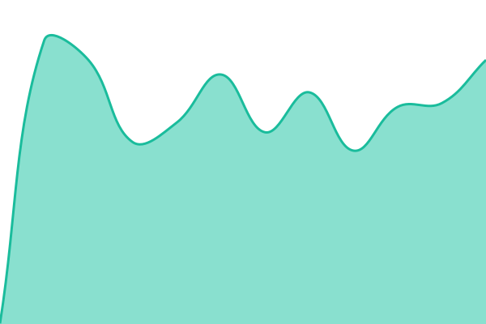 409ms
     
 | 

<a href="https://bingosabah.github.io/uptime/history/invest-sabah">100.00%</a>
    

|  [Invest Sabah (bare domain redirect)](https://investsabah.gov.my) | 🟩 Up | [invest-sabah-bare-domain-redirect.yml](https://github.com/bingosabah/uptime/commits/HEAD/history/invest-sabah-bare-domain-redirect.yml) | 

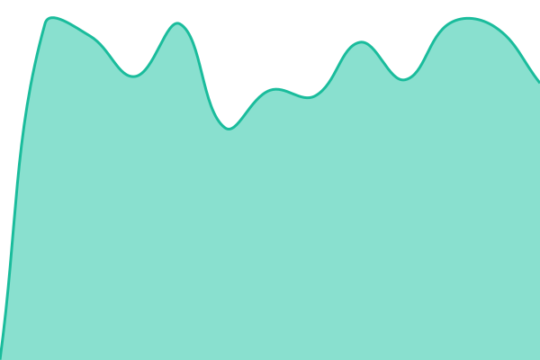 986ms
     
 | 

<a href="https://bingosabah.github.io/uptime/history/invest-sabah-bare-domain-redirect">100.00%</a>
    

|  [Platinum Dental](https://platinumdental.com.my) | 🟩 Up | [platinum-dental.yml](https://github.com/bingosabah/uptime/commits/HEAD/history/platinum-dental.yml) | 

 218ms
     
 | 

<a href="https://bingosabah.github.io/uptime/history/platinum-dental">100.00%</a>
    

|  [FTS Chin Dental](https://ftsdental.com) | 🟩 Up | [fts-chin-dental.yml](https://github.com/bingosabah/uptime/commits/HEAD/history/fts-chin-dental.yml) | 

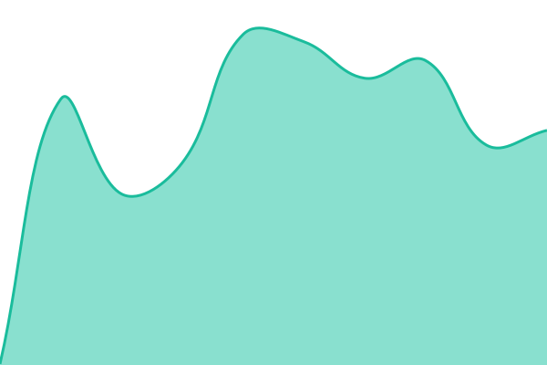 226ms
     
 | 

<a href="https://bingosabah.github.io/uptime/history/fts-chin-dental">100.00%</a>
    

|  [KKIMD (DBKK)](https://kkimd.com.my) | 🟩 Up | [kkimd-dbkk.yml](https://github.com/bingosabah/uptime/commits/HEAD/history/kkimd-dbkk.yml) | 

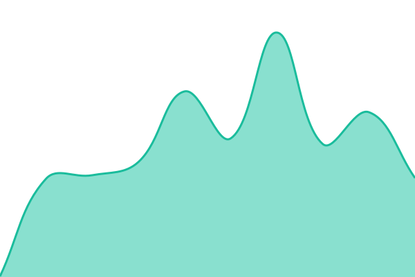 196ms
     
 | 

<a href="https://bingosabah.github.io/uptime/history/kkimd-dbkk">100.00%</a>
    

|  [ZEAL](https://zealserviceindustry.com) | 🟩 Up | [zeal.yml](https://github.com/bingosabah/uptime/commits/HEAD/history/zeal.yml) | 

 248ms
     
 | 

<a href="https://bingosabah.github.io/uptime/history/zeal">100.00%</a>
    

|  [EasySolar](https://www.easysolar.com.my) | 🟩 Up | [easy-solar.yml](https://github.com/bingosabah/uptime/commits/HEAD/history/easy-solar.yml) | 

 547ms
     
 | 

<a href="https://bingosabah.github.io/uptime/history/easy-solar">100.00%</a>
    

|  [Jesselton Point](https://jesseltonpoint.com.my) | 🟩 Up | [jesselton-point.yml](https://github.com/bingosabah/uptime/commits/HEAD/history/jesselton-point.yml) | 

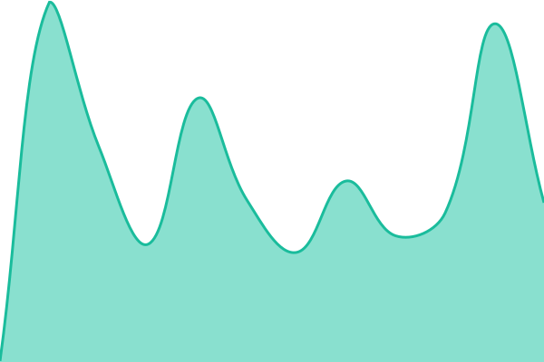 196ms
     
 | 

<a href="https://bingosabah.github.io/uptime/history/jesselton-point">100.00%</a>
    

|  [Procraft](https://procraft.com.my) | 🟩 Up | [procraft.yml](https://github.com/bingosabah/uptime/commits/HEAD/history/procraft.yml) | 

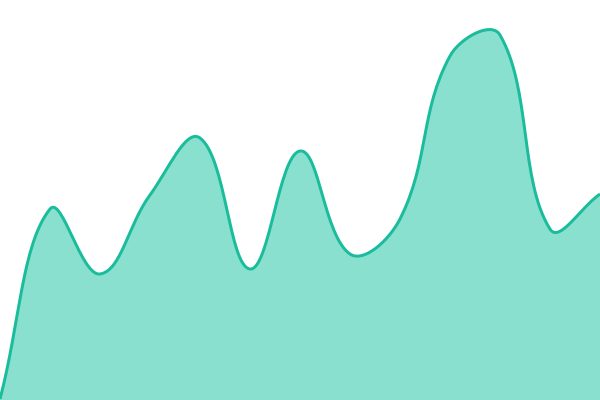 234ms
     
 | 

<a href="https://bingosabah.github.io/uptime/history/procraft">100.00%</a>
    

|  [The BIG G](https://thebigg.com.my) | 🟩 Up | [the-big-g.yml](https://github.com/bingosabah/uptime/commits/HEAD/history/the-big-g.yml) | 

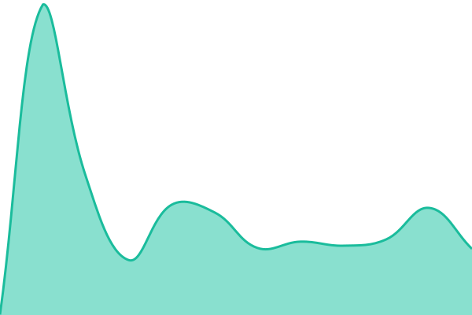 197ms
     
 | 

<a href="https://bingosabah.github.io/uptime/history/the-big-g">100.00%</a>
    

|  [OGSE](https://ogse-sabah.pages.dev) | 🟩 Up | [ogse.yml](https://github.com/bingosabah/uptime/commits/HEAD/history/ogse.yml) | 

 282ms
     
 | 

<a href="https://bingosabah.github.io/uptime/history/ogse">100.00%</a>
    

|  [SWWICE](https://swwice.com) | 🟩 Up | [swwice.yml](https://github.com/bingosabah/uptime/commits/HEAD/history/swwice.yml) | 

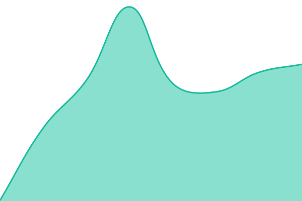 286ms
     
 | 

<a href="https://bingosabah.github.io/uptime/history/swwice">100.00%</a>
    

|  [WMK Cold Room](https://wmkcoldroomrefrigeration.com) | 🟩 Up | [wmk-cold-room.yml](https://github.com/bingosabah/uptime/commits/HEAD/history/wmk-cold-room.yml) | 

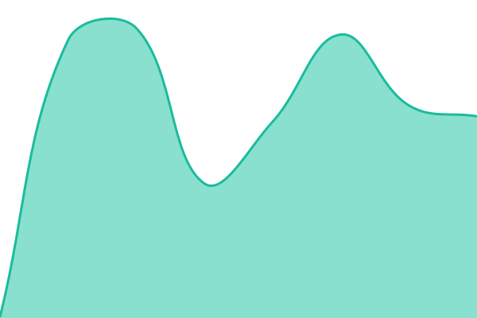 288ms
     
 | 

<a href="https://bingosabah.github.io/uptime/history/wmk-cold-room">100.00%</a>
    

|  [Borneo Wildlife Holidays](https://borneowildlifeholidays.com) | 🟩 Up | [borneo-wildlife-holidays.yml](https://github.com/bingosabah/uptime/commits/HEAD/history/borneo-wildlife-holidays.yml) | 

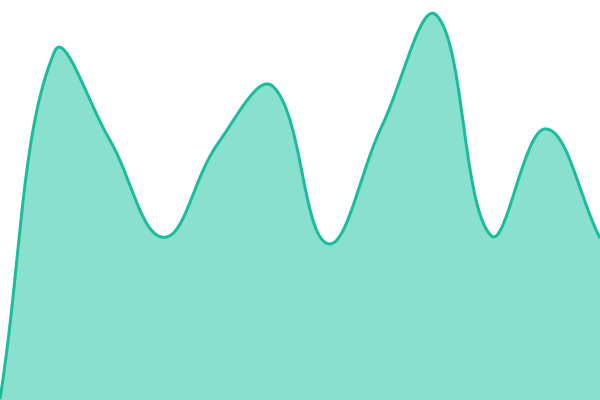 285ms
     
 | 

<a href="https://bingosabah.github.io/uptime/history/borneo-wildlife-holidays">100.00%</a>
    

|  [SP Marine Services (SPSB)](https://www.spmarineservices.com.my) | 🟩 Up | [sp-marine-services-spsb.yml](https://github.com/bingosabah/uptime/commits/HEAD/history/sp-marine-services-spsb.yml) | 

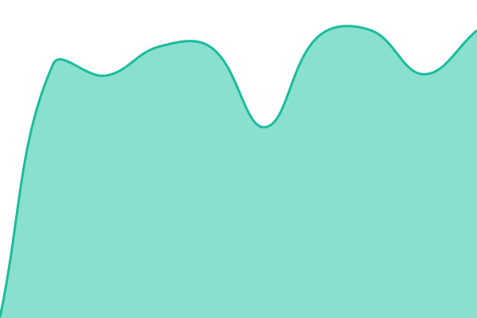 574ms
     
 | 

<a href="https://bingosabah.github.io/uptime/history/sp-marine-services-spsb">100.00%</a>
    

|  [SP Marine Services (bare domain redirect)](https://spmarineservices.com.my) | 🟩 Up | [sp-marine-services-bare-domain-redirect.yml](https://github.com/bingosabah/uptime/commits/HEAD/history/sp-marine-services-bare-domain-redirect.yml) | 

 927ms
     
 | 

<a href="https://bingosabah.github.io/uptime/history/sp-marine-services-bare-domain-redirect">100.00%</a>
    

|  [Borneo Recovery](https://borneorecovery.com) | 🟩 Up | [borneo-recovery.yml](https://github.com/bingosabah/uptime/commits/HEAD/history/borneo-recovery.yml) | 

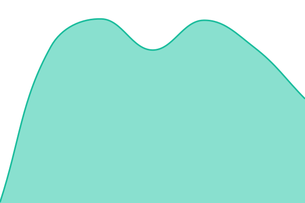 265ms
     
 | 

<a href="https://bingosabah.github.io/uptime/history/borneo-recovery">100.00%</a>
    

|  [Kama'a landing page](https://go.kama.com.my) | 🟩 Up | [kama-a-landing-page.yml](https://github.com/bingosabah/uptime/commits/HEAD/history/kama-a-landing-page.yml) | 

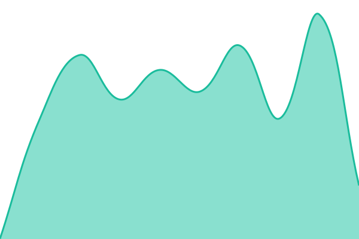 488ms
     
 | 

<a href="https://bingosabah.github.io/uptime/history/kama-a-landing-page">100.00%</a>
    

|  [Bingo Web Design](https://bingowebdesign.my) | 🟩 Up | [bingo-web-design.yml](https://github.com/bingosabah/uptime/commits/HEAD/history/bingo-web-design.yml) | 

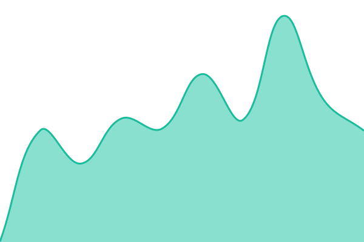 218ms
     
 | 

<a href="https://bingosabah.github.io/uptime/history/bingo-web-design">100.00%</a>
    

|  [Bingo Progress boards](https://bingo-progress.pages.dev) | 🟩 Up | [bingo-progress-boards.yml](https://github.com/bingosabah/uptime/commits/HEAD/history/bingo-progress-boards.yml) | 

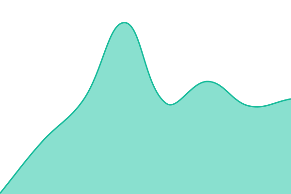 130ms
     
 | 

<a href="https://bingosabah.github.io/uptime/history/bingo-progress-boards">100.00%</a>
    

|  [HelloReply](https://helloreply.my) | 🟩 Up | [hello-reply.yml](https://github.com/bingosabah/uptime/commits/HEAD/history/hello-reply.yml) | 

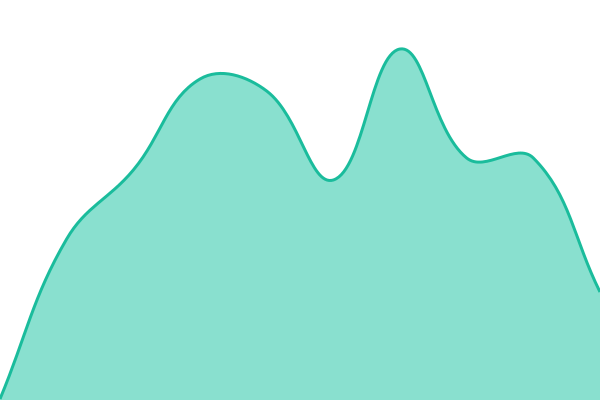 213ms
     
 | 

<a href="https://bingosabah.github.io/uptime/history/hello-reply">100.00%</a>
    

|  [SabahGuide](https://sabahguide.com) | 🟩 Up | [sabah-guide.yml](https://github.com/bingosabah/uptime/commits/HEAD/history/sabah-guide.yml) | 

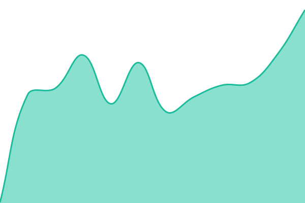 201ms
     
 | 

<a href="https://bingosabah.github.io/uptime/history/sabah-guide">100.00%</a>
    

|  [Bagasi](https://bagasi.my) | 🟩 Up | [bagasi.yml](https://github.com/bingosabah/uptime/commits/HEAD/history/bagasi.yml) | 

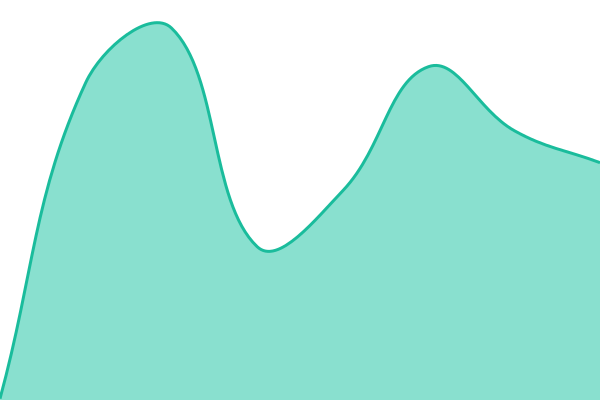 216ms
     
 | 

<a href="https://bingosabah.github.io/uptime/history/bagasi">100.00%</a>
    

|  [GoReview](https://goreview.my) | 🟩 Up | [go-review.yml](https://github.com/bingosabah/uptime/commits/HEAD/history/go-review.yml) | 

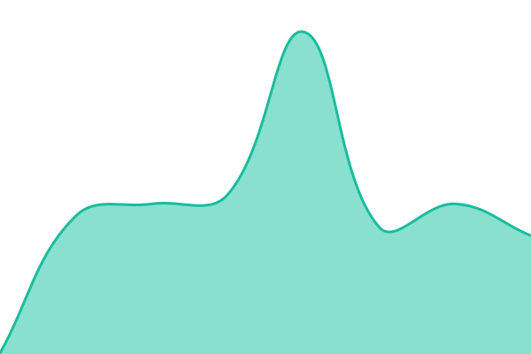 189ms
     
 | 

<a href="https://bingosabah.github.io/uptime/history/go-review">100.00%</a>
    

|  [danielwong.me](https://danielwong.me) | 🟩 Up | [danielwong-me.yml](https://github.com/bingosabah/uptime/commits/HEAD/history/danielwong-me.yml) | 

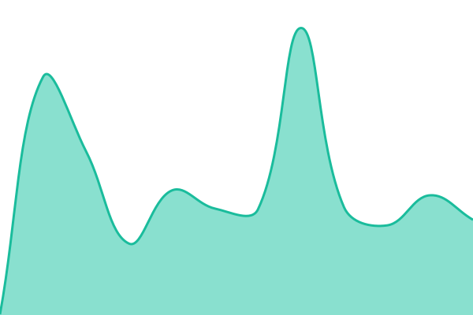 194ms
     
 | 

<a href="https://bingosabah.github.io/uptime/history/danielwong-me">100.00%</a>
    

|  [MU Scalp](https://hairlosstreatment.com.my) | 🟩 Up | [mu-scalp.yml](https://github.com/bingosabah/uptime/commits/HEAD/history/mu-scalp.yml) | 

 196ms
     
 | 

<a href="https://bingosabah.github.io/uptime/history/mu-scalp">100.00%</a>
    

|  [MOQS Movand Academy](https://www.movand.com.my) | 🟩 Up | [moqs-movand-academy.yml](https://github.com/bingosabah/uptime/commits/HEAD/history/moqs-movand-academy.yml) | 

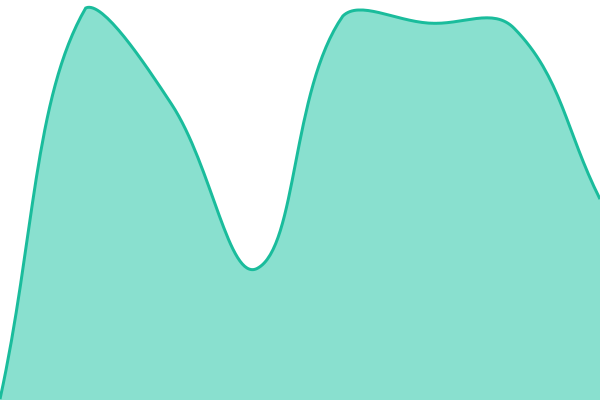 281ms
     
 | 

<a href="https://bingosabah.github.io/uptime/history/moqs-movand-academy">100.00%</a>
    

|  [Asian Supply Base](https://asiansupplybase.my) | 🟩 Up | [asian-supply-base.yml](https://github.com/bingosabah/uptime/commits/HEAD/history/asian-supply-base.yml) | 

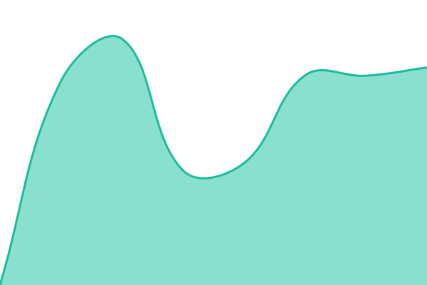 2366ms
     
 | 

<a href="https://bingosabah.github.io/uptime/history/asian-supply-base">100.00%</a>
    

|  [The Palace Hotel KK](https://thepalacehotelkk.com) | 🟩 Up | [the-palace-hotel-kk.yml](https://github.com/bingosabah/uptime/commits/HEAD/history/the-palace-hotel-kk.yml) | 

 1410ms
     
 | 

<a href="https://bingosabah.github.io/uptime/history/the-palace-hotel-kk">100.00%</a>
    

|  [Kim Teck Cheong](https://kimteckcheong.com) | 🟩 Up | [kim-teck-cheong.yml](https://github.com/bingosabah/uptime/commits/HEAD/history/kim-teck-cheong.yml) | 

 1387ms
     
 | 

<a href="https://bingosabah.github.io/uptime/history/kim-teck-cheong">100.00%</a>
    

|  [Sabah Ports (SPSB)](https://spsb.com.my) | 🟩 Up | [sabah-ports-spsb.yml](https://github.com/bingosabah/uptime/commits/HEAD/history/sabah-ports-spsb.yml) | 

 2960ms
     
 | 

<a href="https://bingosabah.github.io/uptime/history/sabah-ports-spsb">100.00%</a>
    

|  [Suria Group](https://suriagroup.com.my) | 🟩 Up | [suria-group.yml](https://github.com/bingosabah/uptime/commits/HEAD/history/suria-group.yml) | 

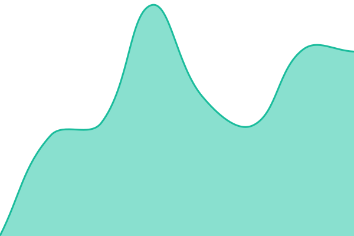 562ms
     
 | 

<a href="https://bingosabah.github.io/uptime/history/suria-group">100.00%</a>
    

|  [Emas Dinamik](https://emasdinamik.com) | 🟩 Up | [emas-dinamik.yml](https://github.com/bingosabah/uptime/commits/HEAD/history/emas-dinamik.yml) | 

 3819ms
     
 | 

<a href="https://bingosabah.github.io/uptime/history/emas-dinamik">100.00%</a>
    

|  [Klinik Malaysia](https://klinikmalaysia.com.my) | 🟩 Up | [klinik-malaysia.yml](https://github.com/bingosabah/uptime/commits/HEAD/history/klinik-malaysia.yml) | 

 1403ms
     
 | 

<a href="https://bingosabah.github.io/uptime/history/klinik-malaysia">100.00%</a>
    

|  [Doncaster Hill Dental](https://doncasterhilldental.com.au) | 🟩 Up | [doncaster-hill-dental.yml](https://github.com/bingosabah/uptime/commits/HEAD/history/doncaster-hill-dental.yml) | 

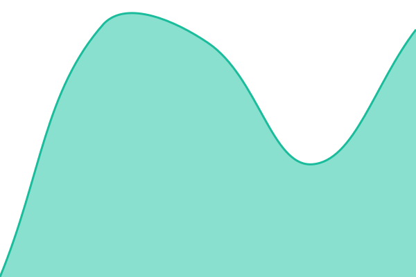 2201ms
     
 | 

<a href="https://bingosabah.github.io/uptime/history/doncaster-hill-dental">100.00%</a>
    

|  [Evolusi Bersatu](https://evolusi-bersatu.com) | 🟩 Up | [evolusi-bersatu.yml](https://github.com/bingosabah/uptime/commits/HEAD/history/evolusi-bersatu.yml) | 

 3033ms
     
 | 

<a href="https://bingosabah.github.io/uptime/history/evolusi-bersatu">100.00%</a>
    

<!--end: status pages-->

[**Visit our status website →**](https://bingosabah.github.io/uptime)

## 📄 License

- Powered by: [Upptime](https://github.com/upptime/upptime)
- Code: [MIT](./LICENSE) © [Anand Chowdhary](https://anandchowdhary.com)
- Data in the `./history` directory: [Open Database License](https://opendatacommons.org/licenses/odbl/1-0/)
